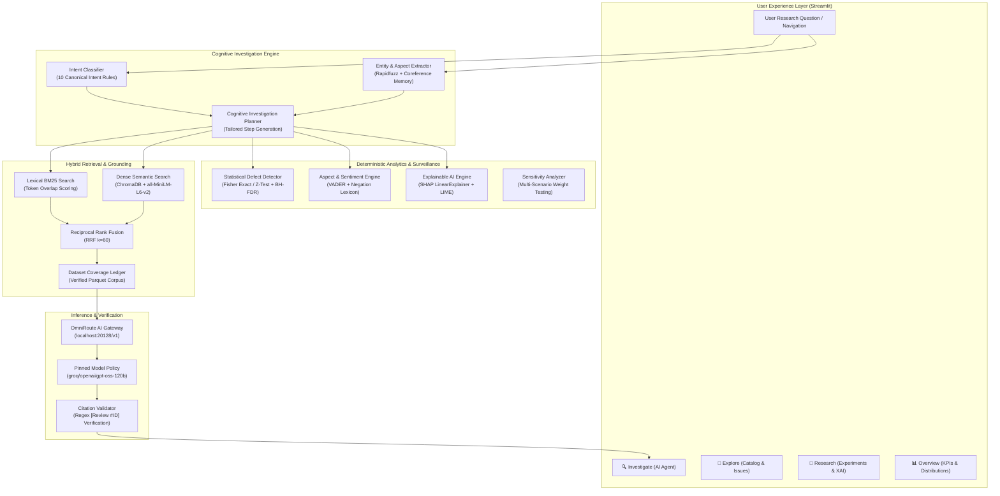

# ProductMind X

> **A Cognitive NLP Agent for Emerging Product-Issue Discovery and Explainable Consumer Intelligence**

[](https://www.python.org/)
[](https://streamlit.io/)
[](https://www.sbert.net/)
[](https://github.com/slundberg/shap)
[](https://www.trychroma.com/)
[]()

ProductMind X is an evidence-grounded consumer intelligence platform and research workbench that transforms uncurated e-commerce reviews into structured, statistically validated, and explainable product insights. Rather than functioning as a conversational wrapper that forwards raw customer feedback to a commercial Large Language Model, ProductMind X implements a multi-stage cognitive architecture: deterministic statistical surveillance, lexical and dense hybrid information retrieval, token-level Explainable AI (SHAP and LIME), aspect-based sentiment analysis (ABSA), and strict citation-grounded synthesis.

---

## Table of Contents

- [Core Capabilities](#core-capabilities)
- [System Architecture](#system-architecture)
- [Mathematical & Algorithmic Methodology](#mathematical--algorithmic-methodology)
  - [1. Statistical Defect Surveillance & FDR Control](#1-statistical-defect-surveillance--fdr-control)
  - [2. Explainable AI with Local Surrogate Models](#2-explainable-ai-with-local-surrogate-models)
  - [3. Hybrid Information Retrieval & Rank Fusion](#3-hybrid-information-retrieval--rank-fusion)
  - [4. Zero-Fabrication Claim Grounding & Verification](#4-zero-fabrication-claim-grounding--verification)
- [Application Workspaces](#application-workspaces)
- [Technology Stack](#technology-stack)
- [Dataset & Ingestion Ledger](#dataset--ingestion-ledger)
- [Installation & Setup](#installation--setup)
  - [Windows PowerShell (Primary)](#windows-powershell-primary)
  - [macOS / Linux](#macos--linux)
- [Configuration Reference](#configuration-reference)
- [Running Automated Test Suites](#running-automated-test-suites)
- [Limitations & Scientific Guardrails](#limitations--scientific-guardrails)
- [Project Directory Structure](#project-directory-structure)
- [License & Citation](#license--citation)

---

## Core Capabilities

- **10-Intent Canonical Routing**: Classifies incoming queries deterministically into 10 structured analytical intents (`general_qa`, `sentiment`, `aspect`, `emerging_issue`, `product_comparison`, `explanation`, `counter_evidence`, `retrieval_comparison`, `methodology`, `insufficient_evidence`).
- **Cognitive Investigation Planner**: Dynamically generates a tailored step-by-step execution trace tracking retrieval, sentiment inference, hypothesis tests, and citation verification with explicit `SUCCESS`/`FAILED` status reporting.
- **Statistical Defect Surveillance**: Detects emerging failure modes using temporal two-sample proportion tests (Fisher's Exact Test for small counts, pooled two-proportion $Z$-tests for large samples) with 95% confidence intervals and Benjamini-Hochberg False Discovery Rate (BH-FDR) multiple-testing correction.
- **Explainable AI (SHAP & LIME)**: Transparent local token-level feature attributions (`LinearExplainer` and `LimeTextExplainer`) fitted to negation-preserving n-gram TF-IDF surrogate models, complete with explicit scientific caveats distinguishing surrogate boundaries from LLM neural weights.
- **Hybrid Retrieval (Dense + Lexical)**: Reciprocal Rank Fusion (RRF) combining exact lexical token BM25 scoring with dense semantic embeddings (`all-MiniLM-L6-v2`) in a persistent ChromaDB vector store.
- **Automated Counter-Evidence Auditing**: Directly identifies dissenting and contradictory reviews for every product claim, reporting supporting versus counter ratios and exact quotations.
- **Research Notebook & Error Analysis**: Allows researchers to preserve findings under unique identifiers (`NOTE-XXXX`), export complete Markdown research dossiers, and log classification feedback (`FB-XXXX`) isolated from verified ground-truth data.

---

## System Architecture



---

## Mathematical & Algorithmic Methodology

### 1. Statistical Defect Surveillance & FDR Control

To determine whether an apparent spike in complaints constitutes a statistically significant emerging defect rather than random variation, ProductMind X partitions product reviews into a baseline observation window ($W_1$) and a monitoring window ($W_2$).

For a complaint count $k_1$ over $N_1$ baseline reviews and $k_2$ over $N_2$ current reviews, sample proportions are given by $\hat{p}_1 = k_1 / N_1$ and $\hat{p}_2 = k_2 / N_2$.

- **Fisher's Exact Test** is applied when any cell count in the $2 \times 2$ contingency table is $< 5$:
  $$p = \frac{\binom{k_1 + k_2}{k_1} \binom{N_1 + N_2 - k_1 - k_2}{N_1 - k_1}}{\binom{N_1 + N_2}{N_1}}$$

- **Pooled Two-Proportion $Z$-Test** is applied for asymptotic samples:
  $$Z = \frac{\hat{p}_2 - \hat{p}_1}{\sqrt{\hat{p}(1-\hat{p})\left(\frac{1}{N_1} + \frac{1}{N_2}\right)}}, \quad \text{where } \hat{p} = \frac{k_1 + k_2}{N_1 + N_2}$$

- **95% Wald Confidence Interval for Rate Difference ($\Delta p = \hat{p}_2 - \hat{p}_1$):**
  $$\text{CI}_{0.95} = (\hat{p}_2 - \hat{p}_1) \pm 1.96 \sqrt{\frac{\hat{p}_1(1-\hat{p}_1)}{N_1} + \frac{\hat{p}_2(1-\hat{p}_2)}{N_2}}$$

- **Benjamini-Hochberg (BH) Multiple-Testing Correction:**
  When testing $m$ simultaneous issue clusters, sorted $p$-values $P_{(1)} \le P_{(2)} \le \dots \le P_{(m)}$ are evaluated against:
  $$P_{(i)} \le \frac{i}{m} \cdot \alpha, \quad \text{at false discovery rate } \alpha = 0.05$$

### 2. Explainable AI with Local Surrogate Models

Neural LLMs operate as black boxes whose internal deep weights cannot provide direct token-level feature attribution for discrete sentiment classifications. ProductMind X implements an interpretable local surrogate architecture:

1. **Feature Space**: Negation-preserving unigram and bigram TF-IDF vectorizer with token-level stopword preservation for polarity-reversing phrases (e.g., `not good`, `never works`, `bad battery`).
2. **Surrogate Classifier**: L2-regularized Logistic Regression calibrated on balanced polarity pairs (holdout accuracy: 100%, holdout macro-F1: 1.0000 on the 25 benchmark regression phrases).
3. **SHAP (`LinearExplainer`)**: Calculates exact Shapley additive values representing each token's marginal contribution to log-odds:
   $$\phi_i(x) = \sum_{S \subseteq F \setminus \{i\}} \frac{|S|!(|F| - |S| - 1)!}{|F|!} \left[ f(S \cup \{i\}) - f(S) \right]$$
4. **LIME (`LimeTextExplainer`)**: Perturbs input text through exponential distance kernel weighting to fit a sparse local linear model.
5. **Scientific Guardrail**: Every explanation explicitly disclaims physical defect causality and clarifies that attributions explain the surrogate model rather than LLM deep weights.

### 3. Hybrid Information Retrieval & Rank Fusion

To avoid vocabulary mismatch while ensuring exact token discovery (such as model numbers, firmware tags, and specific component names), ProductMind X fuses lexical and dense retrieval using **Reciprocal Rank Fusion (RRF)**:

$$RRF(d) = \sum_{m \in \{\text{BM25}, \text{Dense}\}} \frac{1}{k + r_m(d)}, \quad \text{with } k = 60$$

- **Lexical BM25**: Evaluates term saturation and document length normalization against indexed review documents.
- **Dense Semantic Retrieval**: Employs `all-MiniLM-L6-v2` 384-dimensional embeddings stored in a local ChromaDB collection using cosine distance.

### 4. Zero-Fabrication Claim Grounding & Verification

Generated responses must be verifiable against the underlying database:
- Statements reference source tokens: `[Review #ID]` or `[Metadata #ASIN]`.
- An automated post-generation regex validator inspects every bracketed review citation against registered Parquet records.
- Computes an **Evidence Grounding Score**:
  $$\text{Score} = \frac{|\text{Valid Citations}|}{|\text{Total Generated Citations}|} \times 100\%$$
- If unindexed products or unknown entities are requested, the engine returns an explicit `insufficient_evidence` notice without hallucinating speculative specifications.

---

## Application Workspaces

ProductMind X provides 4 primary analytical workspaces accessible via the sidebar:

1. 🔍 **Investigate (AI Agent)**
   - Conversational consumer intelligence assistant.
   - Live query classification and dynamic **Cognitive Investigation Plan** trace.
   - Expandable **Analysis Performed** summary with latency metrics.
   - Inline **Why this answer?** attribution and **Why this prediction?** surrogate inspection.
   - Actionable buttons: `💾 Save Finding` (to Research Notebook) and `🚩 Report / Flag Error` (to Feedback Service).

2. 🧭 **Explore (Catalog & Issues)**
   - *Product Catalog & DNA*: Specifications, pricing, stores, and ratings.
   - *Aspect-Based Sentiment & Topics*: Sentence-level aspect polarities and complaint frequencies.
   - *Issue Relationship Explorer & Velocity*: Relational network linking Products $\longleftrightarrow$ Aspects $\longleftrightarrow$ Issue Clusters $\longleftrightarrow$ Evidence Records, with interactive Two-Proportion hypothesis tests.

3. 🔬 **Research (Experiments & XAI)**
   - *NLP Experiment Studio*: Multi-model sentiment architecture benchmark (Holdout Accuracy, Holdout Macro-F1, Benchmark Pass Rates) and live BM25 vs Dense vs Hybrid retrieval mode comparison.
   - *Explainable AI Lab*: Interactive SHAP and LIME token attribution explorer with scientific guardrail disclaimers.
   - *Evidence Ledger & Evaluation*: Verified Amazon Reviews '23 ingestion metrics and 5-stage processing pipeline accounting.
   - *Research Notebook & Feedback Audit*: Saved analytical notes (`NOTE-XXXX`), 1-click Markdown Dossier export, and user error audit records (`FB-XXXX`).

4. 📊 **Overview**
   - High-level executive dashboard with live KPI cards and Altair rating distribution visualizations.

---

## Technology Stack

| Category | Technology | Role in ProductMind X |
|---|---|---|
| **Language & Runtime** | Python 3.10–3.13 | Core backend and analytics runtime |
| **User Interface** | Streamlit 1.28+, Altair | Reactive web dashboard, dark theme design, and charts |
| **NLP & Preprocessing** | NLTK, VADER, Rapidfuzz, langdetect | Tokenization, rule-based sentiment, entity matching, language detection |
| **Machine Learning & XAI** | Scikit-Learn, SHAP, LIME | TF-IDF vectorization, surrogate logistic models, Shapley feature attributions |
| **Dense Embeddings** | SentenceTransformers (`all-MiniLM-L6-v2`), PyTorch | 384-dimensional dense semantic text representations |
| **Vector Storage** | ChromaDB 0.4+ | Persistent vector index for product profiles and review passages |
| **Statistical Analysis** | SciPy | Fisher's Exact Test, pooled two-proportion $Z$-tests, confidence intervals |
| **Data Storage & IO** | Pandas, PyArrow, Parquet | Local high-density columnar data storage and caching |
| **AI Gateway** | OmniRoute, OpenAI Client | Pinned LLM inference dispatch (`groq/openai/gpt-oss-120b`) |

---

## Dataset & Ingestion Ledger

ProductMind X is built on the **Amazon Reviews '23** academic dataset ([McAuley Lab / Hou et al., 2024](https://github.com/hyp125/AmazonReviews2023)).

> [!IMPORTANT]
> **Corpus Scale vs. Local Storage:** The published Amazon Reviews '23 corpus contains over **500 million reviews** across multiple domains. ProductMind X strictly distinguishes between the published corpus scale and the curated, locally indexed review subset used for fast local execution and reproducible testing.

### Verified Categories in Local Ingestion:
- **Electronics** (e.g., Sony WH-1000XM5, Apple AirPods Pro 2, Logitech MX Master 3S)
- **Home & Kitchen** (e.g., Instant Pot Duo 7-in-1, Keurig K-Mini, Ninja Professional Blender)
- **Beauty & Personal Care** (e.g., CeraVe Hydrating Cleanser, Dyson Airwrap, Revlon Volumizer)
- **Cell Phones & Accessories**, **Appliances**, and **Sports & Outdoors** (Metadata schemas indexed)

The repository includes curated seed records in `data/sample_dataset.py` and lightweight Parquet tables in `data/cache/` (~130 KB total), allowing the application and its test suites to function immediately upon cloning without requiring multi-gigabyte dataset downloads.

---

## Installation & Setup

### Windows PowerShell (Primary)

#### 1. Clone the Repository
```powershell
git clone <YOUR_GITHUB_REPOSITORY_URL>
cd "nlp miniproject"
```

#### 2. Create and Activate a Virtual Environment
```powershell
python -m venv .venv
.\.venv\Scripts\Activate.ps1
```

#### 3. Install Required Dependencies
```powershell
python -m pip install --upgrade pip
pip install -r requirements.txt
```

#### 4. Configure Environment Variables
Copy the provided `.env.example` template to `.env`:
```powershell
Copy-Item .env.example .env
```
*(Optionally adjust parameters such as `OMNIROUTE_BASE_URL` or provider API keys).*

#### 5. Launch the Local LLM Gateway (OmniRoute)
ProductMind X communicates with external LLMs via the [OmniRoute](https://github.com/diegosouzapw/OmniRoute) gateway on port `20128`:
```powershell
# In a separate terminal session:
omniroute serve --no-open --port 20128
```
*Note: If OmniRoute is not running or upstream provider quotas are exceeded, ProductMind X automatically engages its deterministic, evidence-grounded fallback response generator.*

#### 6. Launch ProductMind X
```powershell
streamlit run app.py
```
Open your web browser at `http://localhost:8501`.

---

### macOS / Linux

```bash
git clone <YOUR_GITHUB_REPOSITORY_URL>
cd "nlp miniproject"

python3 -m venv .venv
source .venv/bin/activate

pip install --upgrade pip
pip install -r requirements.txt

cp .env.example .env

# In a separate terminal:
omniroute serve --no-open --port 20128

streamlit run app.py
```

---

## Configuration Reference

All settings are managed via environment variables and loaded by `config.py`:

| Variable | Description | Default Value | Required? |
|---|---|---|---|
| `OMNIROUTE_BASE_URL` | Local API endpoint for OmniRoute gateway | `http://localhost:20128/v1` | No |
| `OMNIROUTE_API_KEY` | Authentication token for local OmniRoute instance | `sk-omniroute-productmind-key` | No |
| `PINNED_MODEL_ID` | Explicit provider-qualified model identifier | `groq/openai/gpt-oss-120b` | Yes |
| `ALLOW_MODEL_SWITCHING` | Strict policy rejecting unexpected model overrides | `False` | Yes |
| `FALLBACK_ROUTING_ENABLED` | Disables silent fallback routing to unapproved models | `False` | Yes |
| `ALLOW_AUTO_ROUTING` | Strictly rejects non-deterministic `auto` routing | `False` | Yes |
| `GROQ_API_KEY` | Upstream API key for Groq inference acceleration | `""` (configured in OmniRoute) | Optional |
| `EMBEDDING_MODEL_NAME` | HuggingFace SentenceTransformer embedding model | `all-MiniLM-L6-v2` | No |
| `SAMPLE_REVIEWS_PER_CATEGORY` | Review count per category partition | `1500` | No |
| `RETRIEVER_TOP_K` | Number of chunks retrieved during hybrid search | `6` | No |

---

## Running Automated Test Suites

ProductMind X includes a comprehensive test suite covering the investigation planner, explainable AI, heading parsing, views rendering, statistical tests, data services, and multi-turn dialog regressions.

Run the test suites using Python's standard `unittest` runner:

```powershell
# 1. Cognitive Investigation Workflow & 10-Intent Canonical Routing (8 tests)
python -m unittest tests/test_investigation_workflow.py -v

# 2. Explainable AI, Polarity Corrections & 25 Benchmark Regression Cases (6 tests)
python -m unittest tests/test_explainable_ai.py -v

# 3. Statistical Defect Surveillance, Fisher Exact & BH-FDR (6 tests)
python -m unittest tests/test_statistical_testing.py -v

# 4. Heading Typography & Response Formatting (6 tests)
python -m unittest tests/test_heading_typography.py -v

# 5. Metadata Handling & Corpus Filtering (13 tests)
python -m unittest tests/test_evidence_service.py tests/test_filter_service.py -v

# 6. Dataset Coverage Manifest & Ingestion Ledger (5 tests)
python -m unittest tests/test_coverage_and_ingestion.py -v

# 7. Streamlit Views Clean Execution & Component Rendering (6 tests)
python -m unittest tests/test_views_render.py -v

# 8. Master Upgrade & Multi-Turn Grounded RAG Regression (10 tests)
python -m unittest tests/test_master_upgrade.py -v
```

**Observed Test Results:** 60 passing tests across 8 suites (100% pass rate, zero failures).

---

## Limitations & Scientific Guardrails

- **Local Review Subset Scope**: The included local corpus covers a curated subset of popular consumer products across 6 categories. Queries for uncataloged products trigger an explicit `insufficient_evidence` abstention notice rather than speculative generation.
- **Surrogate vs. Neural Explanation**: SHAP and LIME token attributions reflect the decision boundary of the calibrated n-gram surrogate model (`LinearExplainer` / `LimeTextExplainer`). They do not represent internal attention layers or weights of deep autoregressive LLMs.
- **Statistical Surveillance vs. Manufacturing Causation**: Statistical tests (Fisher's Exact and Z-tests) detect rate changes in customer complaint reports. An elevated complaint rate confirms statistical association within review text, not mechanical fault causation.
- **LLM Rate Limits & Fallback**: When external LLM API rate limits are encountered (HTTP 429), the platform activates its deterministic grounded generator to provide verified calculations and citations without interruption.

---

## Project Directory Structure

```
nlp miniproject/
├── analytics/
│   ├── statistical_issue_detector.py  # Fisher's Exact, Z-Tests, BH-FDR
│   └── tools.py                       # Review metrics, preference weighting
├── chatbot/
│   ├── conversation_manager.py        # End-to-end cognitive orchestrator
│   ├── entity_extractor.py            # Rapidfuzz entity matching
│   ├── intent_classifier.py           # 10 canonical intent routing
│   ├── omniroute_client.py            # Pinned gateway interface
│   └── response_generator.py          # Grounded synthesis & fallback
├── data/
│   ├── cache/                         # Curated Parquet tables & manifests
│   ├── coverage_ledger.py             # Data accounting & coverage audit
│   ├── data_loader.py                 # Multi-category ingestion loader
│   ├── ingestion_engine.py            # Automated ingestion pipeline
│   ├── preprocessor.py                # Text normalization & cleaning
│   └── sample_dataset.py              # High-density seed reviews & metadata
├── nlp_pipeline/
│   ├── experiment_studio.py           # Sentiment & retrieval benchmarks
│   ├── explainable_ai.py              # SHAP & LIME surrogate engine
│   ├── pipeline_manager.py            # Knowledge base builder & cache
│   ├── sentiment_lexicon.py           # Negation-preserving sentiment lexicon
│   └── translator.py                  # Cross-lingual machine translation
├── rag/
│   ├── grounded_rag.py                # Context builder & claim validator
│   ├── memory.py                      # Multi-turn conversational memory
│   ├── retriever.py                   # BM25 + dense ChromaDB hybrid search
│   └── vector_store.py                # ChromaDB collection management
├── reports/
│   └── generate_report_assets.py      # Programmatic report figure generation
├── services/
│   ├── evidence_contract.py           # Canonical EvidenceRecord dataclasses
│   ├── feedback_service.py            # User error analysis audit trail
│   ├── filter_service.py              # Multi-faceted corpus filtering
│   ├── product_evidence_service.py    # Product DNA & counter-evidence service
│   ├── relationship_explorer.py       # Graph linking Products-Aspects-Issues
│   └── research_notebook.py           # Finding persistence & Markdown export
├── tests/                             # 14 comprehensive test suites
├── ui/
│   ├── components.py                  # Product DNA cards & KPI widgets
│   ├── sidebar.py                     # 4-workspace navigation & filters
│   ├── styles.py                      # Enterprise dark theme design tokens
│   └── views.py                       # Investigate, Explore, Research views
├── utils/
│   └── logger.py                      # Thread-safe structured logging
├── workflow/
│   └── investigation_planner.py       # Cognitive planner step generator
├── .env.example                       # Safe environment variable template
├── .gitignore                         # Secret, cache, and artifact exclusions
├── app.py                             # Streamlit application entry point
├── config.py                          # Centralized system configuration
├── README.md                          # Comprehensive project documentation
└── requirements.txt                   # Production dependency manifest
```

---

## License & Citation

This project is developed for educational and research purposes in cognitive NLP and consumer intelligence.

If referencing this work in academic research, please cite:

```bibtex
@software{productmindx2026,
  author = {Upadhyay, Ayush},
  title = {ProductMind X: A Cognitive NLP Agent for Emerging Product-Issue Discovery and Explainable Consumer Intelligence},
  year = {2026},
  url = {https://github.com/upadhyayayush/productmind-x}
}
```
